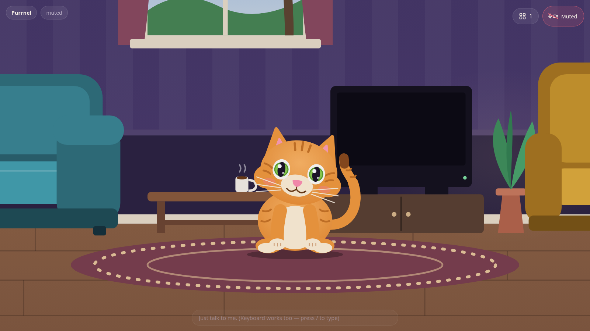
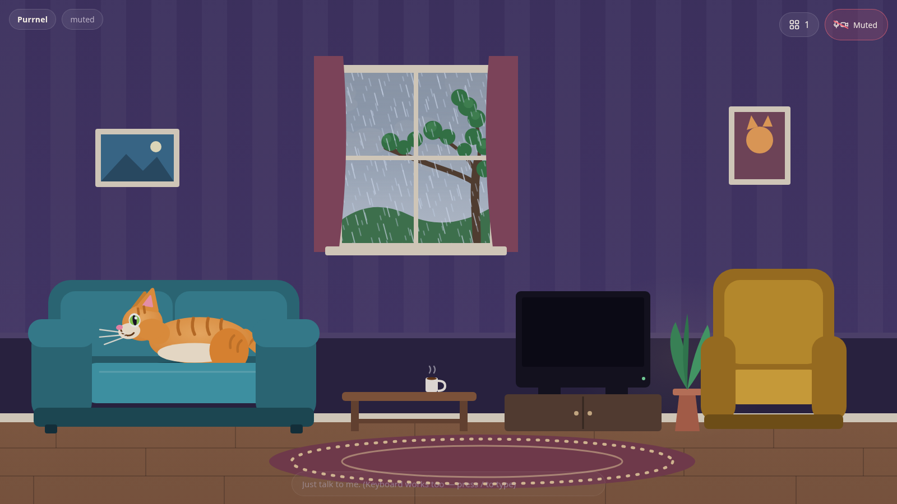
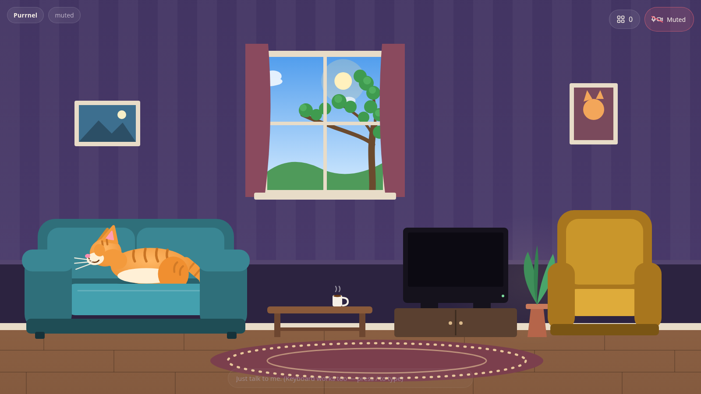
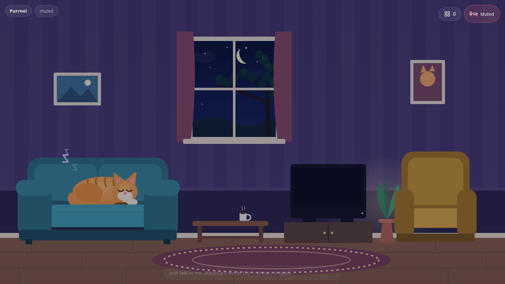

# Purrnel

An operating system that is just an AI agent, fronted by an animated 2D cat who lives in a
lounge room. You talk to her; she listens and watches (unless you mute her). There are no
apps and no files, only **artefacts** that the AI builds for you. See [PLAN.md](PLAN.md) for
the decisions and phases.

<p align="center">
  
  
  
  
</p>

Status: **phase 1 (desktop prototype) is done; phase 2 (image) has started** with a Nix-built
container. The harness runs on a normal Linux desktop and serves the room to a browser window,
or runs in the container below. Booting from USB is the next step of phase 2.

## Run it

One-time setup (models are gitignored, about 140 MB):

```bash
mkdir -p models && cd models
curl -LO https://huggingface.co/ggerganov/whisper.cpp/resolve/main/ggml-base.en-q5_1.bin
curl -LO https://huggingface.co/rhasspy/piper-voices/resolve/main/en/en_US/lessac/medium/en_US-lessac-medium.onnx
curl -LO https://huggingface.co/rhasspy/piper-voices/resolve/main/en/en_US/lessac/medium/en_US-lessac-medium.onnx.json
```

You also need `nix` (whisper.cpp comes from nixpkgs), `pipx install piper-tts`, `ffmpeg`
(camera and the voice pitch shift) and PulseAudio/PipeWire (`parec`, `paplay`).

```bash
~/dev/purrnel/scripts/dev.sh
```

and open <http://127.0.0.1:7979>. The first time, if there is no API key or no place for the
weather, a box asks for them (the key is saved to `~/.config/purrnel/api_key`, readable by you
only, and the place to `~/.config/purrnel/location`). The sliders button in the corner reopens it
any time. You can also set `ANTHROPIC_API_KEY` or write those files yourself. Just talk. `M` toggles mute, `/` focuses the keyboard box.
Click the cat to pet her (she purrs). Click the TV to reopen the last artefact.

Without a key the cat still starts, tells you it has no brain (and asks for the key), and everything local works.
While you test, watch the terminal: each turn logs how long every stage took, e.g.
`[+ 360ms] transcribed`, `[+1500ms] first token`, `[+2100ms] speaking`.

## What she can do

She has a real body in a lounge room (sofa, armchair, coffee table with a mug, TV, window,
rug). When she talks to you she turns to face you and the camera zooms in; the rest of the
time the camera pulls back and she lives her life.

- **Because you ask** (Claude calls the `act` tool): walk_to, run_to, jump_on, jump_down, sit,
  loaf, stretch, groom, scratch (the sofa or armchair), furball, knock_cup, chase_tail,
  zoomies, watch_tv. Several can be chained, and she keeps talking while she does them.
- **Feelings** (`emote`): happy, purr, curious, wave, yawn, love, hiss. Some come with a sound.
- **Sleep** (`go_to_sleep`): she walks to the sofa/armchair/rug/table/TV/window, curls up and
  stays asleep until you type to her or say her name. Room noise doesn't wake her.
- **On her own:** quiet for 60 s and she gets bored and a bit crazy (zoomies, scratching,
  knocking the mug off the table, chasing her tail, the odd furball); after 150 s she's worn
  out and yawns on the sofa; at 180 s she curls up and falls asleep.
- **The internet:** she can search the web and read pages (Anthropic's hosted `web_search` and
  `web_fetch` tools) for news, weather, sports and facts, and artefacts can fetch live data from
  public APIs when you ask for it. Web search must be enabled for your organisation in the
  Claude Console; if the API rejects it, run with `PURRNEL_WEB=0`.
- **The window:** it shows your real local time of day (dawn, day, sunset, night with moon and
  stars) and your **real local weather**: clear, cloudy, overcast, fog, drizzle, rain, snow or a
  thunderstorm with lightning, with the tree swaying in the wind and the room dimming on a grey
  day. A tree outside gets the odd visit from a sparrow, blue tit or robin (not in the rain). When
  she's free (not talking, busy or asleep) she hops on the sill and chatters at them.
- **Visitors:** about as often as the birds, a dog wanders into the lounge. She freezes, her back
  and tail puff up and she hisses until it yelps and bolts. Birds and dogs never visit at the same time, and
  neither comes while she is talking to you.
- **Camera:** `look` takes one picture when it helps. It never streams, and never while muted.
- **Artefacts:** Claude builds them as sandboxed HTML pages with versioned history. They open
  big over the room with a small live cat in the corner.

### Weather and privacy

The weather comes from [Open-Meteo](https://open-meteo.com) (free, no key) every 15 minutes. Only a
coarse place is sent: by default the city from your system timezone (for example `Pacific/Auckland`
becomes "Auckland"), which is looked up once to get coordinates, and those coordinates go with each
weather request. Nothing else leaves the machine. Set `PURRNEL_LOCATION="Your Town"` for a more
exact spot, or `PURRNEL_WEATHER=0` to switch it off. Offline, the window keeps its last weather.
The place you type in the settings box can be "Town" or "Town, Country" and applies straight away.

### Feedback

The speech-bubble button in the corner opens a short form (bug, idea or other, a title and some
details) that becomes an issue on this GitHub repository. You can also just ask the cat ("tell the
developers the dog is too big") and she fills the form in for you to check. **Issues on a public
repository are public**, and the form says so.

GitHub does the login. Normally the button opens GitHub's own "new issue" page in a new tab with
everything filled in, and you press *Submit new issue* (it asks you to log in first if you aren't).
If you give Purrnel a token (`PURRNEL_GITHUB_TOKEN`, or `~/.config/purrnel/github_token`, a
fine-grained token with *Issues: write* on the repository) it posts the issue itself instead. Fork
it? Point feedback at your own repository with `PURRNEL_REPO=owner/name`.

The websocket only accepts connections from the page itself, so another website open in your
browser cannot talk to the cat or change her settings.

## How it fits together

```
mic (parec) -> VAD -> whisper-server -> hub -> Claude (streaming) -> tools
                                         |                          |
camera (ffmpeg, on demand) <-- look -----+       artefact store <---+
                                         |
Piper worker (pitch-shifted) + cat sounds -> paplay (+ mouth levels) -+--> websocket --> room UI
```

- `crates/purrnel-core`: cat states and timeline, the single mute control, risk levels, and
  the versioned content-addressed **artefact store**.
- `crates/purrnel-harness`: the daemon (`audio`, `stt`, `tts`, `camera`, `brain`, `hub`, `server`).
- `ui/index.html`: the whole UI: the room, the front-facing and side-on cat rigs, the curled-up
  sleeper, the behaviour engine and the camera. Behaviours are plain `async` functions in `ACTS`.
- `tools/tts_worker.py`: persistent Piper worker (loads the voice once, pitch-shifts with ffmpeg).
- `tools/make_sfx.py`: synthesises the cat noises (including the hiss) into `assets/sfx/`.
- `tools/mock_anthropic.py`: a fake streaming API for testing without a key.

Cat noises written as words ("mrow", "mew", "mrrp", "purr") are played as sounds instead of
being spoken. **The sounds are synthetic and a first attempt**: replace them with real
recordings by dropping `meow1.wav`, `mew1.wav`, `mrrp1.wav`, `purr1.wav`, `chatter1.wav`,
`hiss1.wav`, `yelp1.wav`... into `assets/sfx/`. The hiss also plays for the `hiss` emote.

**Sounds clipped at the start or end?** Sound cards that suspend when idle (and amplifiers or TVs on
a digital S/PDIF or HDMI link, which lose the signal each time a stream stops) can swallow the
first or last moments of a sound. Purrnel holds a silent stream open the whole time it runs, and
pads every sound with a little silence. `PURRNEL_KEEPALIVE=0` turns the silent stream off.

## Configuration (environment variables)

| Variable | Default |
|---|---|
| `ANTHROPIC_API_KEY` | falls back to `~/.config/purrnel/api_key` |
| `PURRNEL_MODEL` | `claude-sonnet-5-5` (chosen for speed; try `claude-opus-5-5` for more depth) |
| `PURRNEL_FALLBACKS` | on; `0` disables the server-side refusal fallback beta |
| `PURRNEL_WEB` | on; `0` turns off web search and page reading |
| `PURRNEL_PITCH` | `1.3` voice pitch multiplier (1.0 = as recorded) |
| `PURRNEL_SPEED` | `0.92` Piper length scale (lower is faster) |
| `PURRNEL_WEATHER` | on; `0` turns off the real-weather lookup (the window then shows fair weather) |
| `PURRNEL_LOCATION` | place name for the weather; default is the city of your system timezone |
| `PURRNEL_CONFIG` | `~/.config/purrnel` (where the saved key, location and token live) |
| `PURRNEL_GITHUB_TOKEN`, `PURRNEL_REPO` | optional token to post feedback issues directly; repository for them (`Jonesie/purrnel`) |
| `PURRNEL_KEEPALIVE` | on; `0` stops the silent stream that keeps the sound card awake (see below) |
| `PURRNEL_LAT`, `PURRNEL_LON` | exact coordinates for the weather (override the place name) |
| `PURRNEL_PORT` | `7979` |
| `PURRNEL_BIND` | `127.0.0.1` (localhost only; the container sets `0.0.0.0` and publishes the port on the host's localhost) |
| `PURRNEL_DATA` | `~/.local/share/purrnel` |
| `PURRNEL_MIC` | default PulseAudio source |
| `PURRNEL_CAMERA` | `/dev/video0` |
| `PURRNEL_WHISPER_BIN`, `PURRNEL_WHISPER_MODEL`, `PURRNEL_VOICE`, `PURRNEL_PIPER_PYTHON`, `PURRNEL_SFX` | see `config.rs` |
| `PURRNEL_API_URL` | the real API; point at the mock for tests |

## Tests

```bash
cargo test                              # 53 unit tests
cargo test -- --ignored camera          # needs a webcam
```

The UI has no automated tests; it was checked by driving it in a browser. From the browser
console, `room.ACTS`, `room.Cat`, `room.setState('sleeping')`, `onAct([{do:'scratch'}])`,
`room.setHour(22)` (fake the time of day), `room.setWeather({code: 63, cloud: 100, wind: 25}, true)`
(fake the weather; codes are WMO, e.g. 0 clear, 3 overcast, 45 fog, 63 rain, 73 snow, 95 storm) and
`room.spawnBirds()` / `room.spawnDog()` poke the room directly.

## Container (phase 2, step 1)

The same harness runs in a container built by Nix, which is the first step towards the USB image:
the Nix package is shared, and the container is just a quick way to test it. The image holds
Purrnel and its closure only (no distro, no shell, no package manager) and the speech models are
baked in, so there is nothing to download at run time.

```bash
scripts/docker.sh build     # nix build .#docker, then docker load (the first build takes a while)
scripts/docker.sh run       # UI on http://localhost:7979, this machine only
scripts/docker.sh size      # what is in it
```

- Sound in and out goes through the host's PulseAudio / PipeWire socket; the camera is passed
  through if `/dev/video0` exists. The key, place and artefacts live in the `purrnel-data` volume.
- It runs as your user (`--user`), so the sound server accepts it. Set `PURRNEL_PORT` for another
  port; the port is the same inside and out because the page checks where its websocket comes from.
- **Key and place:** the image starts through `scripts/container-start.sh`, which takes each from
  the first of these that exists:

  | | API key | location (weather) |
  |---|---|---|
  | environment | `ANTHROPIC_API_KEY` | `PURRNEL_LOCATION` |
  | file named in the environment | `ANTHROPIC_API_KEY_FILE` | `PURRNEL_LOCATION_FILE` |
  | Docker secret | `/run/secrets/anthropic_api_key` | `/run/secrets/purrnel_location` |
  | saved in the volume | `/data/config/api_key` | `/data/config/location` |

  If one is still missing and the container has a terminal (`docker run -it`, which
  `scripts/docker.sh run` uses when it can), it asks once, hides what you type for the key, and
  saves the answers in the volume (mode 600); press Enter to skip either. Without a terminal it
  just starts, and the page's first-run dialog asks instead. With `scripts/docker.sh`, the `*_FILE`
  variables name files on your machine, which are mounted read-only as the secrets.
- **Size:** about 414 MB compressed, 880 MB unpacked. Biggest parts: Python with onnxruntime and
  numpy for Piper (585 MB closure, sharing glibc with the rest), whisper.cpp with its llama.cpp
  backend (231 MB closure, including the 57 MB model), ffmpeg (104 MB closure), the Piper voice (60 MB). Trimmed so far: OpenVINO,
  SDL/GTK, Piper's training stack, an unused copy of ffmpeg and ALSA plugins.
  Next candidates: replace Piper's Python with a native build, and the two duplicate 35 MB BLAS copies
  that numpy carries.

### CI and releases

- **Pull requests and `main`** (`.github/workflows/ci.yml`): runs the Rust tests, builds the
  container with Nix (which tests the packaged build again) and starts it with
  `scripts/smoke-test.sh`: page served, speech models loaded, the page's own websocket accepted and
  another website's refused. Format and clippy are checked too but only advisory for now, because
  the code has not been through rustfmt yet.
- **Release** (`.github/workflows/release.yml`): push a version tag and the same build is published
  to `ghcr.io/jonesie/purrnel` as `1.2.3`, `1.2` and `latest` (pre-releases like `v1.2.3-rc1` get
  only their own tag).

  ```bash
  git tag v0.2.0 && git push origin v0.2.0
  docker run ... ghcr.io/jonesie/purrnel:0.2.0
  ```

  The first publish creates the package as private; make it public under the repository's
  Packages settings if others should pull it.
- Without a binary cache each run rebuilds ffmpeg, Piper and whisper.cpp, which is slow. To cache
  them, create a cache at cachix.org and add its name as the repository variable `CACHIX_CACHE` and
  its token as the secret `CACHIX_AUTH_TOKEN`; both workflows use it when set.

## Known gaps in phase 1

- **Never run against the real Anthropic API yet.** The streaming parser, tool loop and
  request shape were tested only against `tools/mock_anthropic.py`. The first real run may need
  small fixes. If the request is rejected, try `PURRNEL_FALLBACKS=0`.
- Half-duplex only: the mic is ignored while she talks, so you can't interrupt her.
- Always-on listening hears every sentence in the room; the model is told to answer `[silent]`
  to speech not meant for it, which costs a call each time. The VAD is energy-based.
- Latency is dominated by the cloud call plus first-sentence speech synthesis; local speech
  recognition is about 0.4 s. The GPU build of whisper.cpp wasn't usable here (no Vulkan GPU).
- Conversation history is append-only and unbounded (no compaction yet).
- Artefacts can call the network (the sandbox only blocks same-origin access, not `fetch`), so a
  badly written one could send its own stored data somewhere. A content-security policy for
  artefacts is the obvious next hardening step.
- The room, furniture and her moves are hand-drawn SVG; some poses and transitions will need polish.
- First-run setup (wifi, key by QR or text prompt) is not built; the key comes from a file.

## License

Purrnel is released under the [MIT License](LICENSE).
